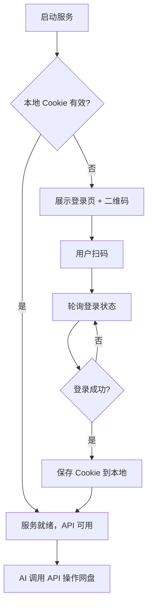

## 1. 产品概述

夸克网盘 AI 工具服务 —— 一个轻量级 HTTP 服务，为 AI Agent 提供夸克网盘的操作能力。仅包含一个二维码登录页面，其余所有功能（文件列表、上传、下载、预览等）均通过 RESTful API 暴露，供 AI 通过 HTTP 调用。

- 目标用户：AI Agent / LLM 工具调用
- 核心价值：让 AI 可以直接操作夸克网盘中的文件

## 2. 核心功能

### 2.1 功能模块

1. **二维码登录**：浏览器打开服务地址，展示二维码供用户扫码登录
2. **Cookie 持久化**：登录后 Cookie 保存到本地文件，重启服务自动恢复
3. **文件管理 API**：列出文件、新建文件夹、删除、重命名、移动
4. **文件上传 API**：上传本地文件到夸克网盘，返回实时进度
5. **文件下载 API**：从夸克网盘下载文件到本地，返回实时进度
6. **文件预览 API**：获取文件预览内容（图片/文本等）

### 2.2 页面详情

| 页面名称 | 模块名称 | 功能描述 |
|----------|----------|----------|
| 登录页 | 二维码展示区 | 已有有效 Cookie 则自动跳过；无 Cookie 则展示二维码 |
| 登录页 | 状态提示 | 实时轮询，提示"请使用夸克 APP 扫码"或"扫码成功" |

## 3. 核心流程



## 4. AI 调用架构

```
AI Agent ──HTTP──▶ 夸克网盘工具服务 (Express) ──代理──▶ 夸克网盘 API
                         │
                         ├── GET  /api/files          → 文件列表
                         ├── POST /api/files/mkdir    → 新建文件夹
                         ├── DELETE /api/files/:id    → 删除文件
                         ├── POST /api/upload         → 上传文件
                         ├── GET  /api/download/:id   → 下载文件
                         ├── GET  /api/preview/:id    → 预览文件
                         ├── GET  /api/auth/status    → 登录状态
                         └── GET  /                  → 二维码登录页
```

## 5. 用户界面设计

### 5.1 设计风格

- 极简风格，仅一个登录页
- 深色背景 + 居中二维码卡片
- 状态提示文字带脉冲动画
- 无需任何其他 UI 组件

### 5.2 登录页设计

| 模块 | UI 元素 |
|------|---------|
| 二维码展示区 | 居中白色卡片，内含二维码图片，下方状态文字 |
| 状态提示 | "请使用夸克 APP 扫码登录" / "扫码成功，正在跳转..." |
| 自动跳转 | 登录成功后 2 秒自动关闭提示，API 立即可用 |