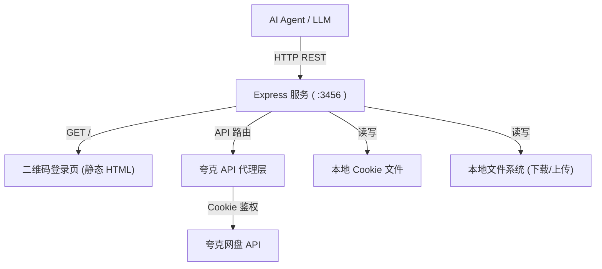
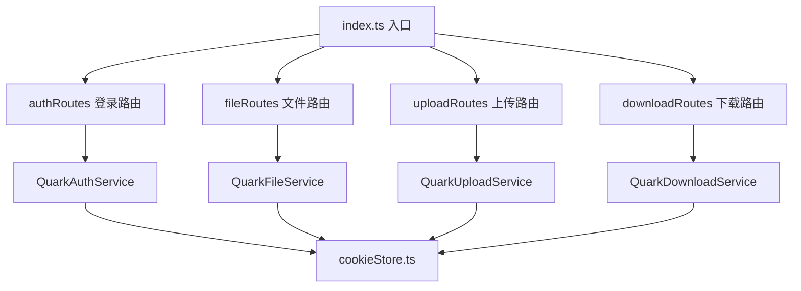

## 1. 架构设计



## 2. 技术选型

- 运行时：Node.js + TypeScript
- 后端：Express@4
- 二维码生成：qrcode（后端直接生成二维码图片 base64）
- Cookie 持久化：本地 JSON 文件存储
- 文件上传：multer（接收上传文件，再转发到夸克 API）
- 进度通知：SSE（Server-Sent Events）推送下载/上传进度
- 前端登录页：纯 HTML（内嵌在 Express 中，无需前端框架）

## 3. 路由定义

| 路由 | 方法 | 用途 |
|------|------|------|
| `/` | GET | 登录页（有 Cookie 时自动重定向到 `/api/auth/status`） |
| `/api/auth/status` | GET | 获取登录状态，返回 `{ logged_in: true/false }` |
| `/api/auth/qrcode` | GET | 获取二维码图片（base64）和 token |
| `/api/auth/logout` | POST | 清除本地 Cookie |
| `/api/files` | GET | 列出文件，参数 `parent_id`（默认根目录`0`）、`page`、`size` |
| `/api/files/mkdir` | POST | 新建文件夹，body `{ parent_id, name }` |
| `/api/files/rename` | POST | 重命名，body `{ file_id, new_name }` |
| `/api/files/delete` | POST | 删除，body `{ file_ids: string[] }` |
| `/api/files/move` | POST | 移动，body `{ file_ids, target_parent_id }` |
| `/api/upload` | POST | 上传文件，multipart/form-data，字段 `file`、`parent_id` |
| `/api/upload/progress/:taskId` | GET | SSE 推送上传进度 |
| `/api/download/:fileId` | GET | 下载文件到本地，返回本地路径 + SSE 进度 |
| `/api/preview/:fileId` | GET | 获取文件预览内容（图片/文本/链接） |

## 4. API 响应格式

### 4.1 统一响应结构

```typescript
// 成功
{ "success": true, "data": { ... } }

// 失败
{ "success": false, "error": "错误信息", "code": "ERROR_CODE" }
```

### 4.2 文件列表

```typescript
GET /api/files?parent_id=0&page=1&size=50

// Response
{
  "success": true,
  "data": {
    "list": [
      {
        "fid": "abc123",
        "file_name": "文档目录",
        "file_type": "folder",       // "folder" | "file"
        "size": 0,
        "updated_at": 1700000000000,
        "thumbnail_url": "https://..."
      }
    ],
    "total": 100,
    "page": 1,
    "size": 50
  }
}
```

### 4.3 上传进度 (SSE)

```typescript
POST /api/upload  → 返回 { taskId: "xxx" }
GET  /api/upload/progress/:taskId  (SSE)

// SSE 事件
event: progress
data: {"uploaded": 1048576, "total": 10485760, "percent": 10, "speed": "2.3 MB/s"}

event: complete
data: {"fid": "abc123", "file_name": "test.mp4"}
```

### 4.4 下载进度 (SSE)

```typescript
GET /api/download/:fileId  (SSE)

// SSE 事件
event: progress
data: {"downloaded": 5242880, "total": 10485760, "percent": 50, "speed": "5.1 MB/s"}

event: complete
data: {"local_path": "/data/downloads/test.mp4", "size": 10485760}
```

## 5. 服务端架构



## 6. 数据模型

### 6.1 Cookie 存储

```json
{
  "cookies": "full_cookie_string_here",
  "updated_at": 1700000000000
}
```

存储路径：`/workspace/.quark_cookies.json`

### 6.2 下载目录

默认下载目录：`/workspace/downloads/`

## 7. 启动方式

```bash
npm install
npm run dev      # 开发模式
npm run build && npm start  # 生产模式
```

服务默认监听 `http://0.0.0.0:3456`

## 8. AI 调用指南

### 8.1 检查服务状态

```bash
# 检查登录状态
curl http://localhost:3456/api/auth/status
# → {"success":true,"data":{"logged_in":true}}
# → {"success":true,"data":{"logged_in":false,"qrcode_url":"http://..."}}
```

### 8.2 列出文件

```bash
# 列出根目录
curl http://localhost:3456/api/files?parent_id=0

# 列出子目录
curl http://localhost:3456/api/files?parent_id=abc123

# 分页
curl http://localhost:3456/api/files?parent_id=0&page=1&size=20
```

### 8.3 上传文件

```bash
curl -X POST http://localhost:3456/api/upload \
  -F "file=@/path/to/local/file.mp4" \
  -F "parent_id=0"
# → {"success":true,"data":{"taskId":"upload_xxx","file_name":"file.mp4","size":10485760}}
```

### 8.4 下载文件

```bash
# 流式下载（带进度）
curl -N http://localhost:3456/api/download/abc123
# 或指定本地路径
curl http://localhost:3456/api/download/abc123?save_path=/custom/path/file.mp4
```

### 8.5 预览文件

```bash
curl http://localhost:3456/api/preview/abc123
# → {"success":true,"data":{"type":"image","url":"https://...","content":"base64..."}}
```

### 8.6 新建文件夹

```bash
curl -X POST http://localhost:3456/api/files/mkdir \
  -H "Content-Type: application/json" \
  -d '{"parent_id":"0","name":"新文件夹"}'
```

### 8.7 删除文件

```bash
curl -X POST http://localhost:3456/api/files/delete \
  -H "Content-Type: application/json" \
  -d '{"file_ids":["abc123","def456"]}'
```

### 8.8 错误码

| 错误码 | 说明 |
|--------|------|
| `NOT_LOGGED_IN` | 未登录，需要打开浏览器扫码 |
| `COOKIE_EXPIRED` | Cookie 已过期，需要重新扫码 |
| `FILE_NOT_FOUND` | 文件不存在 |
| `UPLOAD_FAILED` | 上传失败 |
| `DOWNLOAD_FAILED` | 下载失败 |
| `QUARK_API_ERROR` | 夸克 API 返回错误 |